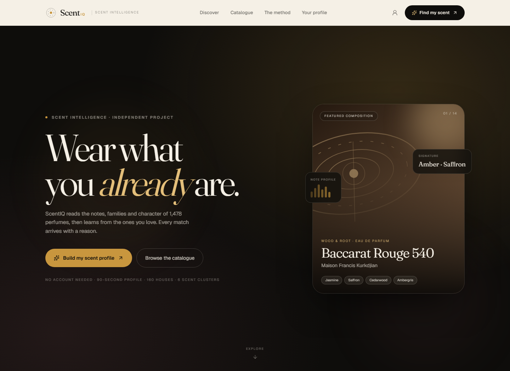
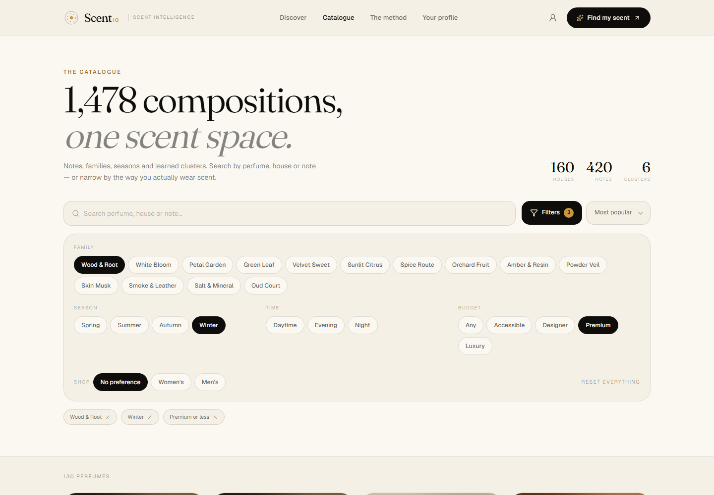
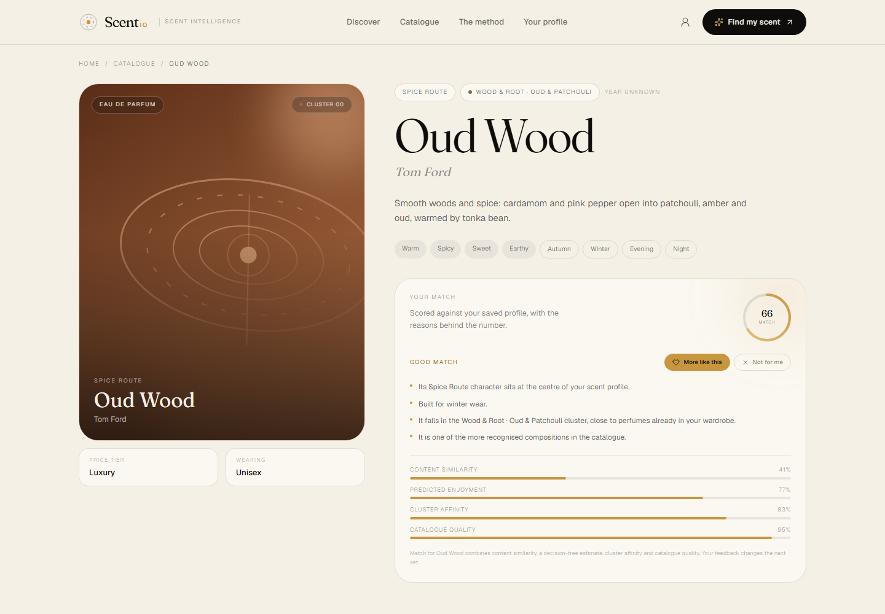
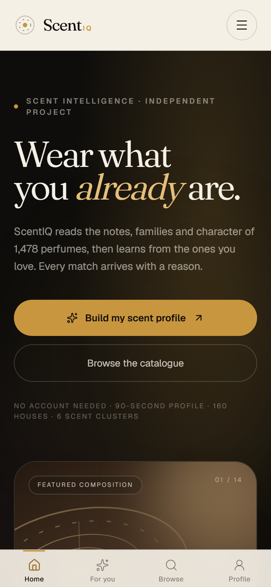
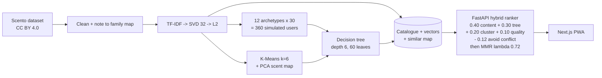

# ScentIQ

**An intelligent, explainable fragrance recommender — not another perfume list.**

**Live:** https://scent-iq.vercel.app · **API:** https://scentiq-api.vercel.app

ScentIQ turns 1,478 perfumes into a searchable scent space, learns what you like
from a 90-second profile and your feedback, and recommends bottles with a match
score plus the reasons behind it. Built as a portfolio-grade full-stack + ML
project on a hard **$0** budget.



## What it does

- **Catalogue** — 1,478 compositions, 160 houses, 420 notes, 14 scent families
  and 6 learned clusters. Search, filter by family/season/time/budget/shop,
  sort, and deep-link any filter state.
- **Perfume pages** — note pyramid, family composition, season and occasion,
  cluster, PCA coordinates, nearest neighbours and a personal match explanation.
- **Onboarding** — families, loved/avoided notes, wardrobe, season, time and
  budget. No account, no email.
- **Discover** — hybrid score from content similarity, a decision tree, cluster
  affinity and catalogue quality, diversified with MMR. Every card says *why*.
- **Feedback loop** — likes and dislikes immediately re-rank the shortlist and
  populate the wardrobe.
- **Profile** — completion score, wardrobe, preferences and feedback, stored in
  the browser and sent to the API only when scoring.
- **PWA** — installable, offline fallback, mobile tab bar, reduced-motion
  support, 44 px targets.
- **Honest model page** — metrics, confusion matrix, feature importance,
  limitations and data ethics at `/about`.

<p>
  
  
</p>


## How the model works



The tree predicts enjoyment from 16 features: note overlap, avoid conflicts,
family cosine, cluster affinity, price fit, season/time/gender match,
popularity, concentration and six cluster indicators. The split is **grouped by
user** (zero user overlap between train and test), so a user's tastes cannot leak
across the split.

| Signal | Result |
| --- | --- |
| K-Means | k=6, silhouette **0.154**, 131–369 perfumes per cluster |
| Training pairs | 57,600 (360 users × 160 candidates, 30% positive) |
| Split | 43,200 train / 14,400 test, 90 held-out users |
| Accuracy | **0.6105** (balanced 0.610) |
| ROC-AUC | **0.6481** |
| Precision@10 | **0.5256** vs 0.4033 family baseline (**1.30× lift**) |
| NDCG@10 | **0.5319** vs 0.4178 baseline |
| Tree | depth 6, 119 nodes, 60 leaves |
| Strongest features | season match (0.407), family cosine (0.208), popularity (0.196), price fit (0.151) |

### Read the numbers honestly

Public perfume datasets do not contain individual ratings. The tree is trained
on **simulated users with hidden preference vectors**, so the metrics measure how
well it recovers that simulator — not real-world enjoyment. The app is a working
recommender with an honest evaluation harness, not a claim of solved taste
prediction. Real feedback collection and retraining are the next phase; the
limitations are documented on `/about` and in the development log.

## Stack

| Layer | Choice | Why |
| --- | --- | --- |
| Web | Next.js 16 (App Router, React 19) | SSR/SEO, partial prerendering, PWA |
| Styling | Tailwind CSS 4, Fraunces + Geist | Custom editorial design system |
| Motion | Motion (React) | Purposeful, reduced-motion-aware animation |
| API | FastAPI + scikit-learn + NumPy/pandas | Small, typed, stateless ML service |
| ML | scikit-learn, joblib, pyarrow | Reproducible offline pipeline |
| Hosting | Vercel Hobby (web + Python API) | $0, one account, no card; large-functions beta fits the ML bundle |
| CI | GitHub Actions | Lint, types, build, ML + API tests (+ optional Render keepalive) |

Taste profiles live in `localStorage`; there is no auth or database in v1. The
frontend falls back to an **on-device ranker** if the free API is cold, so the
product never dead-ends.

## Repository layout

```
apps/web              Next.js PWA (App Router, Tailwind, API route)
services/api          FastAPI app, rate limiting, CORS, tests
ml/src/scentiq_ml     Cleaning, features, clustering, simulation, tree, ranker
ml/artifacts          Trained models, vectors, metrics, similar map
data/processed        Clean catalogue (raw data is not redistributed)
docs                  Deployment guide and media
scripts               PWA icon generator
.github/workflows     CI (+ Render keepalive, unused on Vercel)
render.yaml           Render Blueprint for the API (card required now)
index.py              Vercel serverless entrypoint re-exporting the FastAPI app
requirements.txt      Python deps installed by the Vercel API build
vercel.json           Vercel service definition + catch-all route
ScentIQ_Development_Log.txt  Full build log, decisions and phase plan
```

## Run it locally

Requirements: Node.js 22+, Python 3.12, [uv](https://docs.astral.sh/uv/),
npm.

```bash
# 1. API
cd services/api
uv sync --group dev
uv run uvicorn app.main:app --reload --port 8000

# 2. Web (new terminal)
npm install --prefix apps/web
npm --prefix apps/web run dev
```

Open `http://localhost:3000`. Create `apps/web/.env.local` only if the API is not
on the default port:

```dotenv
NEXT_PUBLIC_API_BASE_URL=http://localhost:8000
NEXT_PUBLIC_SITE_URL=http://localhost:3000
```

Production build and checks:

```bash
npm --prefix apps/web run lint
npm --prefix apps/web run typecheck
npm --prefix apps/web run build

cd ml && uv run pytest
cd services/api && uv run pytest
```

## Deploy for free

Step-by-step: [docs/DEPLOYMENT.md](docs/DEPLOYMENT.md). In short:

1. **API:** from the repo root, `vercel link --project scentiq-api` then
   `vercel --prod`. The root `vercel.json` routes every path to the FastAPI app
   via `index:app`; `vercel env add ALLOWED_ORIGINS production` locks CORS to
   the web origin. If the 500 MB bundle limit is hit, set
   `VERCEL_SUPPORT_LARGE_FUNCTIONS=1` (free beta) and redeploy.
2. **Web:** Vercel project with **Root Directory `apps/web`**, then set
   `NEXT_PUBLIC_API_BASE_URL=https://scentiq-api.vercel.app` and
   `NEXT_PUBLIC_SITE_URL=https://scent-iq.vercel.app`.
3. Optional: `render.yaml` remains for a warm container on Render, which now
   requires a payment method for identity verification.

## Data and attribution

Perfume data: **Scento Perfume Database, CC BY 4.0** —
<https://www.scento.com/perfume-database>. No scraped brand photography or
reviews are used; all visuals are generated SVG/CSS art. Prices are estimated
tiers, never fabricated retail prices.

## Status and roadmap

Shipped: live web app at https://scent-iq.vercel.app with the FastAPI ranking
service live at https://scentiq-api.vercel.app — catalogue, perfume pages,
onboarding, hybrid discovery, explanations, feedback, profile, scent map, PWA,
SEO, CI, deployment configuration. Both run on Vercel Hobby for $0; the API's
scientific stack fits through the large-functions beta.

Next, in priority order:

- Supabase: anonymous feedback table with RLS, optional accounts, cross-device
  profiles.
- Community ratings/reviews (original content) and saved collections.
- Feedback-to-retraining job with a real-data evaluation split.
- Optional Streamlit "Model Lab" if the university requires it.

The full process, decisions, errors and fixes are in
[ScentIQ_Development_Log.txt](ScentIQ_Development_Log.txt).

## Author

Hashir Ansari — [github.com/hashiransari3000](https://github.com/hashiransari3000)
